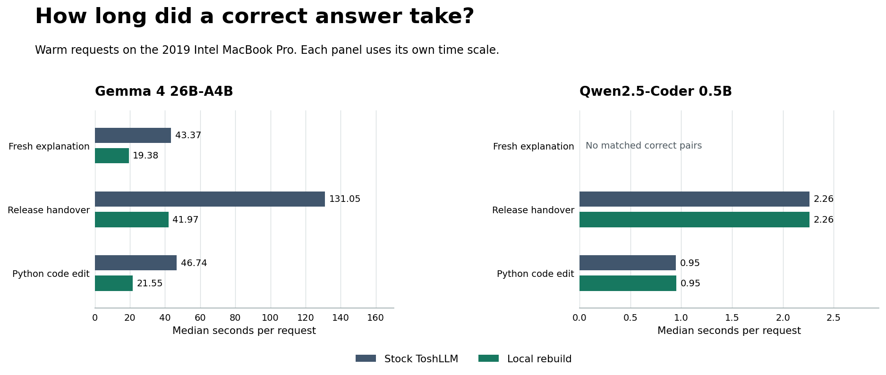

# Time to a correct local answer

The primary comparison uses the released Intel ToshLLM engine and the local rebuild on the same laptop. The paired latency estimates use independent rounds in which both engines passed the frozen correctness checks and received the same formatted prompt. A dash means the estimate is unavailable.

A positive saving means a shorter wait. For each qualifying round, the analysis divides the time saved by that round’s baseline time, then reports the median and the full range of those percentages. The two displayed median times can give a different percentage if divided directly.

## Gemma 4 26B-A4B

No measurement file is available for this model.

## Qwen2.5-Coder 0.5B

Complete. 5/5 planned rounds completed. The raw record contains 0 abandoned round attempts. [Per-request JSON](results/correct-answers-qwen.json)

### Stock and rebuilt

| Task | Stock correct/graded | Rebuilt correct/graded | Correct pairs | Stock median (s) | Rebuilt median (s) | Paired time saved, median [min, max] |
|---|---:|---:|---:|---:|---:|---:|
| First answer after launch | 0/5 | 0/5 | 0/5 | — | — | — |
| Fresh explanation | 0/5 | 0/5 | 0/5 | — | — | — |
| Release handover | 5/5 | 5/5 | 5/5 | 2.26 | 2.26 | +0.04% [-1.02, +1.87] |
| Python code edit | 5/5 | 5/5 | 5/5 | 0.95 | 0.95 | -0.41% [-3.81, +0.82] |
| 144-token decode control | 5/5 | 5/5 | 5/5 | 2.56 | 2.56 | -0.07% [-0.20, +0.79] |

Correct/graded includes all returned answers across retained and abandoned attempts. Correct pairs counts complete matched rounds only. Missing requests and failed grades remain visible in the raw data and summary JSON. A task with zero correct pairs has no time-to-correct estimate.

| Task | First text (s), Stock / Rebuilt | Decode (tokens/s), Stock / Rebuilt | Output token range, Stock / Rebuilt | Same length | Same token IDs |
|---|---:|---:|---:|---:|---:|
| First answer after launch | — / — | — / — | — / — | 0/0 | 0/0 |
| Fresh explanation | — / — | — / — | — / — | 0/0 | 0/0 |
| Release handover | 1.65 / 1.64 | 59.68 / 59.58 | 38 / 38 | 5/5 | 5/5 |
| Python code edit | 0.50 / 0.50 | 59.87 / 59.51 | 28 / 28 | 5/5 | 5/5 |
| 144-token decode control | 0.16 / 0.16 | 59.44 / 59.50 | 144 / 144 | 5/5 | 5/5 |

### Observed startup and reply times, including incorrect answers

Startup runs from process launch until the server reports ready.

| Build | Ready launches | Median startup (s) |
|---|---:|---:|
| Stock | 5 | 0.75 |
| Rebuilt | 5 | 0.76 |

The medians below use every completed reply from each build, including replies from unfinished or abandoned rounds. Correct/graded gives the number of those replies that passed. For the first reply, both times start at process launch. For warm workloads, both start at the client request.

| Task | Build | Correct/graded | Median first text (s) | Median full reply (s) | Median decode (tokens/s) |
|---|---|---:|---:|---:|---:|
| First answer after launch | Stock | 0/5 | 1.04 | 1.06 | 55.23 |
| First answer after launch | Rebuilt | 0/5 | 1.04 | 1.06 | 56.41 |
| Fresh explanation | Stock | 0/5 | 0.38 | 1.70 | 59.78 |
| Fresh explanation | Rebuilt | 0/5 | 0.38 | 1.69 | 60.16 |
| Release handover | Stock | 5/5 | 1.65 | 2.26 | 59.68 |
| Release handover | Rebuilt | 5/5 | 1.64 | 2.26 | 59.58 |
| Python code edit | Stock | 5/5 | 0.50 | 0.95 | 59.87 |
| Python code edit | Rebuilt | 5/5 | 0.50 | 0.95 | 59.51 |
| 144-token decode control | Stock | 5/5 | 0.16 | 2.56 | 59.44 |
| 144-token decode control | Rebuilt | 5/5 | 0.16 | 2.56 | 59.50 |

## Timing and interpretation

For the first answer after launch, the clock starts when the benchmark launches a new server process. The operating system keeps its file cache. Warm times start at the client request, before formatting the model prompt. First-text time uses the first nonempty streamed text. Full request time includes prompt processing and generation. Decode speed uses the engine’s own output-token clock.

Output length can change even when both answers pass. The fixed-length control checks identical token budgets and the required sentence pattern. Each ordinary workload has one held-out prompt per model. Five repetitions of the same prompt measure run-to-run variability on this machine. They give no population-wide accuracy estimate or evidence isolating a single CPU instruction flag.

[Paired medians, spread, and per-round changes](results/paired-summary.json)
